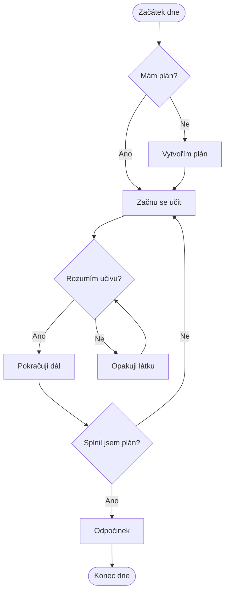

# Master-of-Markdown

# 🎓 Příručka přežití zkouškového období

> „Zkouškové není sprint. Je to maraton, ve kterém nevíš, kde je cílová páska.“

Vítej v příručce, která ti pomůže přežít zkouškové období. Najdeš zde tipy na učení, plánování času a odpočinek.

##  1. Příprava na zkouškové

### 1.1 Plánování je základ

Nejdůležitější je začít včas. Odkládání povinností na poslední chvíli není nejlepší strategie.

Doporučené kroky:

- Sepiš si termíny zkoušek.
- Rozděl si učivo na menší části.
- Každý den si stanov cíl.
- Dělej pravidelné přestávky.
- Nezapomínej na spánek.

*Vnitřní hlas: Ještě jeden díl seriálu přece nemůže uškodit...*

## ☕ 2. Výbava každého studenta

| Pomůcka | Využití | Důležitost |
|---|---|---|
| Notebook | Studium a poznámky | Vysoká |
| Káva | Motivace | Střední |
| Sešit | Zapisování poznámek | Vysoká |
| Sluchátka | Lepší soustředění | Vysoká |
| Spánek | Regenerace mozku | Kritická |

## ⏱️ 3. Metoda Pomodoro

Metoda Pomodoro pomáhá lépe organizovat čas.

1. Nastav časovač na 25 minut.
2. Soustřeď se na studium.
3. Dej si 5 minut přestávku.
4. Po čtyřech cyklech si dopřej delší pauzu.

**Důležité:** Během studia vypni sociální sítě!

## 💻 4. Digitální laboratoř – Python

Ukázka jednoduchého studijního plánu v Pythonu:

```python
ukoly = [
    "Projít přednášky",
    "Vypracovat poznámky",
    "Procvičit příklady",
    "Zopakovat učivo"
]

print("Můj studijní plán:")

for cislo, ukol in enumerate(ukoly, start=1):
    print(f"{cislo}. {ukol}")

print("Hodně štěstí u zkoušky!")
```

## 🌐 5. Užitečné odkazy

- [GitHub – platforma pro programátory](https://github.com/)
- [Pomodoro Technique – organizace času](https://pomofocus.io/)

## 📝 6. Můj studijní To-Do list

- [x] Připravit studijní materiály
- [x] Naplánovat termíny zkoušek
- [ ] Naučit se všechny otázky
- [ ] Procvičit praktické příklady
- [ ] Absolvovat všechny zkoušky
- [ ] Oslavit úspěšné zakončení semestru

## 🧠 7. Matematické okénko

Efektivitu studia můžeme zjednodušeně vyjádřit vzorcem:

$$
E = \frac{V}{T}
$$

Kde:

- **E** = efektivita studia
- **V** = množství zvládnutého učiva
- **T** = čas strávený učením

Cílem je zvládnout co nejvíce učiva za rozumný čas.

## 🔄 8. Rozhodovací diagram studenta



## 🏆 9. Závěrečné hodnocení

Moje tři nejdůležitější pravidla:

1. **Začni včas.**
2. **Uč se pravidelně.**
3. **Nezapomínej na sebe.**

~~Učit se začnu až den před zkouškou.~~

*„Úspěch není o tom, kolik hodin se učíš, ale jak dobře využiješ svůj čas.“*

---

**Autor:** Student  
**Projekt:** Markdown README  
**Rok:** 2026
